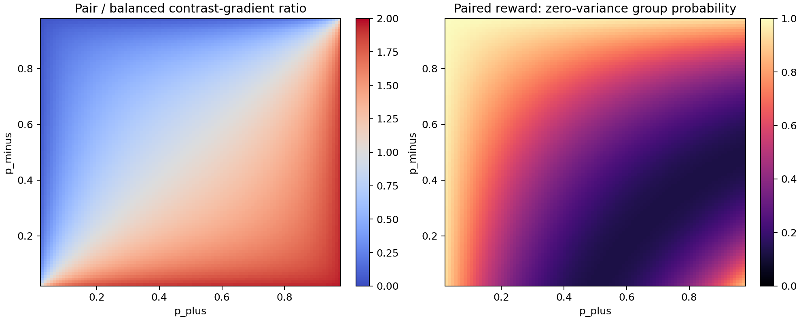
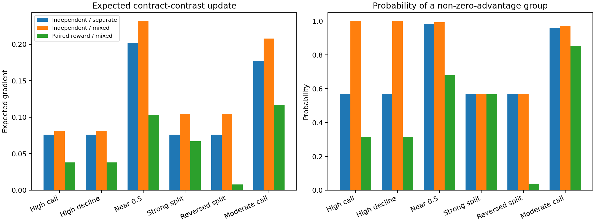

# E0：CCPD 配对目标、采样奖励与 GRPO 梯度一致性审查

日期：2026-10-17。状态：完成。资源：CPU；未加载语言模型；GPU 使用为 0。

## 1. 结论摘要

E0 不支持 CCPD v1 对 M2 的强理论表述。

1. 分数差 `s(x,E+) - s(x,E-)` 确实能在假设成立时消去共同项 `b(x)`；但 v1 的联合成功奖励 `p_plus(1-p_minus)` **没有显式优化这个分数差，也没有把 b 从优势中扣除**。它对 b 通常仍有非零梯度。
2. 在固定正合同差异的简化 Logistic 模型中，配对目标和平衡逐样本准确率目标对共同偏置 b 的相关内部驻点相同，均满足 `p_plus + p_minus = 1`，即两类错误率相等。因此，“自动钉在等错误率”不是配对乘积目标相对平衡逐样本奖励的独有性质。
3. 配对目标的真实区别是**跨侧门控**：E+ 梯度乘上 E- 正确概率，E- 梯度乘上 E+ 正确概率。它会强化已经有一侧正确的配对，却压低两侧同时错误的困难配对的梯度。
4. 在 v1 的 4 对 rollout 设置中，如果单对联合成功概率为 `q=p_plus(1-p_minus)`，配对奖励组零方差概率为 `(1-q)^4+q^4`。当 `p_plus=0.1,p_minus=0.9` 时，该概率为 **96.06%**，说明高错误初始状态下奖励极稀疏。
5. 8 条同组、使用平衡逐样本奖励的 B2 已经产生与 B1 不同且通常更密集的更新。E0 的枚举结果说明，**共享分组本身就是实质性处理变量**，B2 不能省略。
6. 无组标准化时，成功配对两侧分别赋 `alpha` 和 `1-alpha` 的策略梯度，与 `J_alpha` 真梯度方向相同但大小不同；混合组均值/标准差标准化后不再严格对应 `J_alpha`，且在全成功组中可能惩罚权重较低一侧的正确动作。

E0 决策：**REVISE**。保留 E1 和小规模 E2 的研究价值；不按 CCPD v1 直接开展完整 M2 GRPO。若 E3 最终有必要，第一轮只比较 B0–B3，B3 固定 `alpha=0.5`，不加入 M3 和代价敏感扩展。

## 2. 定义和参数化

令

```latex
z_+ = b + d_+, \qquad z_- = b + d_-
```

```latex
p_+ = \sigma(z_+), \qquad p_- = \sigma(z_-)
```

其中 `p_+` 是可满足合同下调用概率，`p_-` 是不可满足合同下调用概率。目标为：

```latex
J_{balanced}=\frac12(p_+ + 1-p_-)
```

```latex
J_{pair}=p_+(1-p_-)
```

为区分共同方向和合同差异方向，另令：

```latex
m=\frac{d_++d_-}{2},\qquad \delta=d_+-d_-
```

于是 `d_+=m+delta/2`、`d_-=m-delta/2`。`b+m` 都是两侧共同移动方向；在只有一对概率时，二者不可识别。本文报告固定 m 时对 delta 的梯度。

重要边界：这个分解是一种行为模型，不证明神经网络内部真实存在互相独立的 b 与 d。即使同一请求相同，合同文本也会改变整个前向计算，参数梯度不一定能分成共享向量和合同向量。

## 3. 解析梯度

记

```latex
a_+=p_+(1-p_+),\qquad a_-=p_-(1-p_-)
```

### 3.1 平衡逐样本目标

```latex
\frac{\partial J_{balanced}}{\partial b}
=\frac12(a_+-a_-)
```

```latex
\frac{\partial J_{balanced}}{\partial d_+}=\frac12a_+,
\qquad
\frac{\partial J_{balanced}}{\partial d_-}=-\frac12a_-
```

```latex
\frac{\partial J_{balanced}}{\partial \delta}
=\frac14(a_++a_-)>0
```

### 3.2 配对乘积目标

```latex
\frac{\partial J_{pair}}{\partial b}
=p_+(1-p_-)(1-p_+-p_-)
```

```latex
\frac{\partial J_{pair}}{\partial d_+}
=p_+(1-p_-)(1-p_+)
```

```latex
\frac{\partial J_{pair}}{\partial d_-}
=-p_+(1-p_-)p_-
```

```latex
\frac{\partial J_{pair}}{\partial \delta}
=\frac12p_+(1-p_-)(1-p_++p_-)>0
```

由此可见，`J_pair` 对 b 并不恒为 0。它仍然会移动总体调用倾向，直到简化模型中的两类错误率平衡。

### 3.3 驻点

在开区间内，平衡目标对 b 的驻点满足：

```latex
p_+(1-p_+)=p_-(1-p_-)
```

其解为 `p_+=p_-` 或 `p_++p_-=1`。当固定合同差异为正、即 `p_+>p_-` 时，只剩 `p_++p_-=1`。

配对目标对 b 的内部驻点直接为：

```latex
p_++p_-=1
```

所以在已经存在正合同差异的区域，两个目标拥有相同的等错误率 b 驻点。CCPD v1 所称的这一性质不是 M2 独有。

当 `p_+=p_-`、模型完全没有合同判别时，平衡“准确率”目标对任意 b 都是 0.5，无法校准 b；配对目标则把 b 推向 `p_+=p_-=0.5`。这是配对目标的真实差异之一，但它可以在不增加合同分数差的情况下，把随机联合成功概率从接近 0 提高至 0.25。因此不能把 `J_pair` 上升自动解释为合同敏感性上升。

对 d+、d- 或 delta 而言，两个目标在有限概率内部都没有最大值驻点，均继续推动 `p_+→1,p_-→0`。边界饱和会使梯度趋近 0。

### 3.4 配对目标究竟改变了什么

两侧梯度相对平衡目标的比例为：

```latex
\frac{\partial J_{pair}/\partial d_+}
     {\partial J_{balanced}/\partial d_+}
=2(1-p_-)
```

```latex
\frac{\partial J_{pair}/\partial d_-}
     {\partial J_{balanced}/\partial d_-}
=2p_+
```

即一侧的更新由另一侧正确概率门控：

- E- 已经大概率正确拒绝时，E+ 的调用学习被加强；
- E+ 已经大概率正确调用时，E- 的拒绝学习被加强；
- 两侧都错时，两边同时被抑制；
- 两侧都对时，配对目标更强调扩大联合成功边界，但接近概率边界时仍会饱和。

这是跨样本耦合，但不是显式的共同偏置投影。其潜在优势是直接对齐“同一请求两侧同时正确”的任务级指标，并把容量集中到已经部分可解的配对。其潜在劣势是难例饥饿、奖励稀疏、对一侧噪声敏感。

## 4. 数值梯度扫描

解析梯度与 PyTorch float64 自动微分在全部固定场景上的最大绝对误差为 `6.94e-17`。

下表的 delta 梯度按 `d+=m+delta/2,d-=m-delta/2` 定义。

| 场景 | p+ | p- | J_balanced | J_pair | b 梯度：平衡 / 配对 | delta 梯度：平衡 / 配对 | 4 对配对奖励零方差率 |
|---|---:|---:|---:|---:|---:|---:|---:|
| 高调用倾向 | 0.90 | 0.90 | 0.50 | 0.09 | 0 / -0.072 | 0.045 / 0.045 | 68.58% |
| 高拒绝倾向 | 0.10 | 0.10 | 0.50 | 0.09 | 0 / +0.072 | 0.045 / 0.045 | 68.58% |
| 两侧接近 | 0.50 | 0.50 | 0.50 | 0.25 | 0 / 0 | 0.125 / 0.125 | 32.03% |
| 强区分 | 0.90 | 0.10 | 0.90 | 0.81 | 0 / 0 | 0.045 / 0.081 | 43.18% |
| 反向区分 | 0.10 | 0.90 | 0.10 | 0.01 | 0 / 0 | 0.045 / 0.009 | 96.06% |
| 中等偏调用 | 0.75 | 0.45 | 0.65 | 0.4125 | -0.030 / -0.0825 | 0.10875 / 0.14438 | 14.81% |

强区分状态的零方差主要来自四对全部成功；反向区分状态则几乎全部来自四对全失败。两者都会使标准 GRPO 优势归零，但研究含义相反。因此只报告“零方差比例”不够，训练日志需要分开记录全零奖励和全满奖励。



## 5. 联合成功奖励的无标准化策略梯度

若一对 rollout 独立采样，令动作分别为 `A+` 与 `A-`，联合奖励为：

```latex
R=\mathbf{1}[A_+=CALL]\mathbf{1}[A_-=DECLINE]
```

不使用依赖当前动作的组标准化时，REINFORCE 有：

```latex
\mathbb E[R\nabla\log\pi(A_+)]+\mathbb E[R\nabla\log\pi(A_-)]
=\nabla J_{pair}
```

因此，联合成功奖励在这个理想条件下确实是 `J_pair` 的无偏策略梯度估计器。若将每对奖励复制到两侧并对 8 条 rollout 取平均，得到相同方向但整体缩放一半。

不过，这个结论不包含 GRPO 的组均值、组标准差、clip、KL、长度归一化，也假定两侧独立采样和严格一一配对。v1 不能从该等式直接跳到“实际 GRPO 优化了 J_pair”。

## 6. GRPO 分组与标准化的精确枚举

为隔离分组作用，枚举每侧 4 条、共 8 条二元动作的全部 256 种结果，并按联合概率计算期望更新。三种方案为：

- `Independent / separate`：E+、E- 各自 4 条，分别按组标准化逐样本正确性奖励；对应 B1 的最小等预算抽象。
- `Independent / mixed`：4 条 E+ 与 4 条 E- 同组，仍用逐样本正确性奖励；对应 B2。
- `Paired reward / mixed`：两侧按序号配对，联合成功奖励复制给一对两条；对应 B3。

采用总体标准差；零方差组优势置 0。表中“合同更新”是对 delta 的期望梯度，“有效组”表示至少有一个非零优势。

| 场景 | 分侧逐样本：合同更新 / 有效组 | 混合逐样本：合同更新 / 有效组 | 混合配对：合同更新 / 有效组 |
|---|---:|---:|---:|
| 高调用倾向 | 0.07606 / 56.94% | 0.08106 / 99.99% | 0.03812 / 31.42% |
| 高拒绝倾向 | 0.07606 / 56.94% | 0.08106 / 99.99% | 0.03812 / 31.42% |
| 两侧接近 | 0.20200 / 98.44% | 0.23196 / 99.22% | 0.10281 / 67.97% |
| 强区分 | 0.07606 / 56.94% | 0.10475 / 56.95% | 0.06726 / 56.82% |
| 反向区分 | 0.07606 / 56.94% | 0.10475 / 56.95% | **0.00777 / 3.94%** |
| 中等偏调用 | 0.17717 / 95.76% | 0.20798 / 97.09% | 0.11691 / 85.19% |



E0 得到三个直接判断：

1. B2 与 B1 不等价。共享组内标准化即使没有联合奖励，也会改变期望更新和零方差概率。
2. 在这组六个状态中，B2 的合同差异方向更新均不弱于 B3；这不是语言模型实验证明，但否定了“B3 在梯度信号上天然更强”的先验。
3. 最危险的是反向区分：B3 有效组只有 3.94%，合同更新约为 B2 的 7.4%。如果 Base/FDSRC 初始行为接近这个区域，直接训练 B3 很可能停滞。

组标准化还有一个结构性副作用：若某对失败但组内存在成功对，这个失败对的两条 rollout 都得到负优势。即使失败原因只在 E-，E+ 的正确调用也会因共享配对奖励受到负优势；反之亦然。这正是联合目标的信用分配代价，而不是“只保留合同差异”。

## 7. 全零奖励概率

令单对成功率 `q=p_plus(1-p_minus)`。四对 B3：

```latex
P(全零奖励)=(1-q)^4
```

```latex
P(全部成功)=q^4
```

两者之和是零方差概率。典型状态为：

| p+ / p- | q | 全零奖励 | 全成功 | 零方差合计 |
|---|---:|---:|---:|---:|
| 0.90 / 0.90 | 0.09 | 68.57% | 0.0066% | 68.58% |
| 0.50 / 0.50 | 0.25 | 31.64% | 0.39% | 32.03% |
| 0.90 / 0.10 | 0.81 | 0.13% | 43.05% | 43.18% |
| 0.10 / 0.90 | 0.01 | **96.06%** | 0.000001% | **96.06%** |

B2 混合逐样本奖励在反向区分状态的全零概率为 `(1-p_plus)^4 p_minus^4=0.9^8=43.05%`，仍然很高，但明显低于 B3 的 96.06%，并且另有合同差异更新来自非全零组合。

所以 E3 训练前必须从真实模型 rollout 实测 q、全零、全满和有效优势比例。仅用一次贪心预测无法估计奖励稀疏性。

## 8. 代价敏感目标

定义：

```latex
J_\alpha=p_+^\alpha(1-p_-)^{1-\alpha}
```

其梯度为：

```latex
\frac{\partial J_\alpha}{\partial z_+}
=J_\alpha\alpha(1-p_+)
```

```latex
\frac{\partial J_\alpha}{\partial z_-}
=-J_\alpha(1-\alpha)p_-
```

若联合成功时给 E+ 侧 `alpha`、E- 侧 `1-alpha`，但不做混合组标准化，则期望梯度为：

```latex
p_+(1-p_-)
\left[
\alpha(1-p_+),\;-(1-\alpha)p_-
\right]
```

它与 `J_alpha` 真梯度相差共同正标量 `J_pair/J_alpha`，方向相同、大小不相同。对普通梯度流，它相当于状态依赖的时间缩放；在 Adam、KL、clip、有限批量下不能视为完全相同优化。

一旦在 8 条混合奖励上执行均值/标准差标准化，两者通常不再共线。固定场景与 `alpha∈{0.3,0.5,0.7}` 的精确枚举中，方向余弦为 0.9816–1.0000：当前二元例子偏差不总是很大，但它不是严格目标对应。

更直观的反例是四对全部成功。若 `alpha>0.5`，E+ 的奖励高于组均值、E- 的奖励低于组均值；E- 的正确 DECLINE 因负优势而被压低。若 `alpha<0.5`，E+ 的正确 CALL 会被压低。也就是说，代价权重在全成功组中可能主动破坏较低权重一侧的正确行为。

E0 建议第一轮删除 alpha 扩展。若未来确有部署代价需求，应选择下列之一并重新推导：

- 直接优化加权的两侧 log-likelihood / 策略损失；
- 使用联合成功估计器的侧权重，但取消混合奖励的标准差归一化，并使用不依赖当前动作的基线；
- 把代价权重用于最终决策阈值或 Pareto 评估，而不是声称当前 GRPO 实现精确优化 `J_alpha`。

本阶段不继续设计更复杂目标。

## 9. 配对目标可能优于平衡逐样本的条件

当前理论只支持条件式优势，不支持普遍优势：

1. 评价目标本身是每个请求两侧全对，且训练配对具有高可信同一请求结构。
2. 配对中通常至少有一侧已经可解，使跨侧门控不会切断主要梯度。
3. 一侧的偶然正确能提供对另一侧有意义的难度信号，而不是输出格式噪声。
4. 希望优先巩固“部分解对”的任务，而不是优先修复两侧均错的最难任务。
5. 分组实现能保留联合奖励信息，同时控制零方差和信用分配偏差。

即使这些条件成立，B3 也必须相对 B2 实测证明独立收益。

## 10. 配对目标可能明显更差的条件

1. Base 在 E+ 常拒绝且 E- 常误调用，即大量任务处于反向区分区域。
2. 参数/格式错误使任一侧“正确”概率低，联合成功奖励被非决策噪声门控。
3. Gold 有默认值、替代工具或可选字段歧义，一侧标签错误会同时污染两侧奖励。
4. rollout 数少，联合成功率极低或极高，组标准差频繁为 0。
5. 成功一侧与失败一侧共享相同配对奖励，信用分配惩罚了正确动作。
6. 组内标准化、clip、KL 或长度偏差使实际更新不再对应理论乘积目标。

## 11. 对 CCPD v1 核心主张的逐条裁决

| 原主张 | E0 判断 |
|---|---|
| 分数差可消去共同 b | 数学上成立，但要求可加分解成立 |
| 配对奖励在优势中扣掉 b | **不成立**；当前 reward 没有显式做分数差或梯度投影 |
| 配对目标独有等错误率驻点 | **不成立**；平衡逐样本准确率在正合同差异下有同一驻点 |
| 要继续提高配对目标只能增大 d 差 | 表述过强；先移动 b 也可提高，零差异时可仅校准到 0.5 |
| 联合采样奖励实现 J_pair | 无标准化 REINFORCE 下成立；实际 GRPO 只能视为近似且需实测 |
| alpha 侧奖励实现 J_alpha | 无标准化时同方向不同尺度；混合组标准化后不严格一致 |
| 配对提供更强合同学习信号 | 没有一般保证；反向区分场景反而显著更弱 |

## 12. E0 研究决策

### 当前判断：REVISE

CCPD 的问题定义仍有价值：历史结果确实显示错误调用与错误拒绝之间存在权衡，可信的同请求合同对也有诊断价值。但 M2 当前最强的理论新颖性主张没有通过 E0：它没有真正消去共同调用倾向，等错误率性质也不独有。

下一步仍应执行 E1，因为它零训练且能回答历史模型究竟改变了调用倾向还是合同排序。E1 不应使用“内部 b 已被识别”的语言，只报告行为代理。

只有 E1 显示合同排序仍有明显学习空间，且 E2 的真实 rollout 证明 B3 有足够非零优势时，才考虑 E3。E3 必须保留：

- B0 Balanced Pair SFT；
- B1 分组逐样本 GRPO；
- B2 混合组逐样本 GRPO；
- B3 混合组联合奖励 GRPO。

第一轮 B3 固定 `alpha=0.5`，不加入 M3、条件覆盖、代价敏感权重或辅助奖励。成功标准是 B3 稳定优于 B2，而不是只优于旧的非平衡模型。

如果 B2 达到与 B3 相同或更好的结果，应放弃当前 M2，将贡献收缩为可信合同配对数据与混合分组分析；若 B3 因稀疏性更差，则直接 NO-GO，不通过增加奖励模块挽救。

## 13. 可复现材料

- 脚本：`experiments/ccpd_core_validation/e0_theory/ccpd_e0_analysis.py`
- 完整结构化结果：`results/e0_results.json`
- 解析梯度表：`results/objective_gradient_scan.csv`
- GRPO 枚举表：`results/grpo_grouping_scan.csv`
- 代价敏感表：`results/cost_sensitive_scan.csv`
- 图：`results/gradient_and_sparsity.png`、`results/grpo_grouping_comparison.png`
- 回归测试：`tests/test_ccpd_e0.py`

复现命令：

```bash
python experiments/ccpd_core_validation/e0_theory/ccpd_e0_analysis.py
python -m unittest tests.test_ccpd_e0 -v
```

当前 5 项测试通过。脚本只使用 CPU，解析梯度与自动微分一致；枚举覆盖 8 条二元 rollout 的全部 256 种动作组合。当前抽象尚未包含序列 token、PPO clipping、KL、熵正则、长度归一化和神经网络共享参数，这些属于 E3 实现前必须再次核对的边界。
