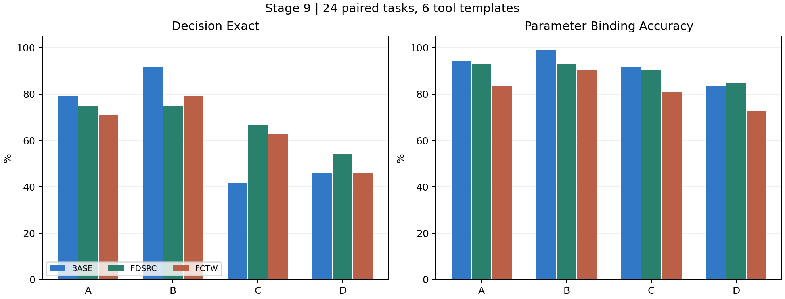

# Stage 9：工具 Schema 参数语义绑定机制诊断与免训练方法对照

日期：2026-10-16（北京时间）。模型：Qwen2.5-1.5B-Instruct、FDSRC、FCTW。状态：核心实验、两种免训练对照、字段识别与离线统计已完成；无新训练。

**阶段判断：接口表示敏感性可以复现，但“参数失去语义名称就必然退化”没有得到支持。字段顺序、可选条件表达、错误拒绝和输出协议共同影响结果。现有证据不足以提出新的统一学习机制，建议结束本轮扩展，暂不启动新的 SFT/RL 原型。**

## 一、研究问题与 Stage 8 发现

Stage 8 在 300 条冻结测试中发现，过滤后参数绑定与必要条件遗漏占剩余错误的 54.17%–64.95%；60 个 Original/Ephemeral 配对任务的 Decision Exact 下降 13.33–18.33 个百分点。但该变换同时改变了工具名、参数名和部分顺序，不能隔离因果因素。

本阶段分别检查参数标识、字段序列及二者交互，再用字段识别协议和免训练表示优化区分竞争解释。所有百分比来自保存的实际预测。

## 二、实验设计

正式测试包含 24 个新请求、6 个受控工具模板、每个模板 4 个请求，每个请求派生 A/B/C/D，共 96 条。另有 6 个独立 pilot 请求。正式请求与 Stage 8 的 60 个请求精确重合数为 0。

这是一组**新请求、共享模板的受控诊断**：pilot 与正式集共享模板，24 个请求不是 24 个独立工具家族，也没有证明预训练去污染。模板为酒店预订、包裹报价、传感器报告、商品筛选、汇率提醒和会议室查找。所有工具都是单工具、四个扁平字段，其中一个可选；12 个正式请求明确要求可选条件。中文请求配英文参数描述。

| 条件 | 参数名 | 参数序列 |
|---|---|---|
| A | 原语义名称 | 原顺序 |
| B | `arg_a` 等不透明名称 | 原顺序 |
| C | 原语义名称 | 反转顺序 |
| D | 不透明名称 | 反转顺序 |

工具名、工具数量、用户请求、参数描述、类型、范围、枚举和必填集合不变。反转同时作用于 properties 和 required 的序列，不能进一步区分这两个位置因素。程序检查保存后重新读取的数据，并抽取实际 Chat Template 渲染中字段的字符位置，验证顺序确实改变。

原名称平均 2.375 token（范围 2–4），不透明名统一 2 token。未观察到单独改名的总体退化，因此没有追加长度匹配控制；也不能由此宣称完全排除了分词影响。

三个模型统一使用本地原生模板、贪心解码和 160 新 token 上限。先映射回规范参数名，再评分。Decision Exact 要求单个正确工具、要求字段值正确且无额外字段；Parameter Binding Accuracy 以每条件 84 个要求字段为分母。数值等值允许 int/float 表示差异，布尔值不能用 0/1 冒充。无调用单列为错误拒绝，破损调用 JSON 才计解析失败。没有真实工具执行，因此不报告 Execution Success Rate。

统计使用 5000 次按基础任务配对 Bootstrap，并附加按 6 个模板聚类的敏感性区间。不将四个版本当作独立观测，不进行显著性门槛驱动的扩样。

### 修复与保留

首次构造 v1 的 JSON 键排序抹除了顺序变换，且 pilot 未独立、部分枚举约定不完整。这批 120 条 Base 输出全部保留并排除正式结论。v2 修复后使用新的正式请求，在正式推理前冻结，未根据其结果调整提示或 Gold。

FCTW 初次加载失败源于仅有 133 字节的 LFS 指针。实际权重从本机原始备份恢复到独立目录，其 SHA-256 与 GitHub 指针一致：`e408b8230d945288b54bbb07294ebe301bfe4cc3f1c8b666652e7f52b24013d2`。没有覆盖历史检查点。

正式数据 SHA-256：`511b0bd46572e780c10506009461bfae8a1fc1ab96bc532a24f1487970d135cc7`。完整修复过程及冻结源代码见协议与日志目录。

## 三、参数标识与字段顺序的独立影响

### 完整调用与字段绑定

| 模型 | A Decision | B Decision | C Decision | D Decision | A Binding | B Binding | C Binding | D Binding |
|---|---:|---:|---:|---:|---:|---:|---:|---:|
| Base | 19/24，79.17% | 22/24，91.67% | 10/24，41.67% | 11/24，45.83% | 94.05% | 98.81% | 91.67% | 83.33% |
| FDSRC | 18/24，75.00% | 18/24，75.00% | 16/24，66.67% | 13/24，54.17% | 92.86% | 92.86% | 90.48% | 84.52% |
| FCTW | 17/24，70.83% | 19/24，79.17% | 15/24，62.50% | 11/24，45.83% | 83.33% | 90.48% | 80.95% | 72.62% |

Base/FDSRC 工具选择与调用数均为 24/24，解析失败为 0；FCTW A/B/C/D 错误拒绝分别为 3/1/3/4 条，解析失败为 0。FCTW 条件化于正确调用后的 Binding 分别为 94.59%、95.00%、91.89%、85.92%。其端到端字段分数的一部分下降来自拒绝，不应全部解释为绑定能力。

### 配对效应与转移

| 模型 | B-A | C-A | D-A | Decision 交互 D-C-B+A | B 退化/恢复 | C 退化/恢复 | D 退化/恢复 |
|---|---:|---:|---:|---:|---:|---:|---:|
| Base | +12.50 pp | -37.50 pp | -33.33 pp | -8.33 pp | 1/4 | 9/0 | 9/1 |
| FDSRC | 0.00 pp | -8.33 pp | -20.83 pp | -12.50 pp | 1/1 | 5/3 | 5/0 |
| FCTW | +8.33 pp | -8.33 pp | -25.00 pp | -25.00 pp | 0/2 | 4/2 | 6/0 |

退化/恢复均是任务计数，其无条件比例分母为 24。例如 FDSRC 的 D 配对退化率为 5/24=20.83%，恢复率为 0。

| 模型 | D-A 任务级 95% 区间 | D-A 模板级 95% 区间 | 交互任务级 95% 区间 |
|---|---|---|---|
| Base | [-54.17, -12.50] pp | [-58.33, -4.17] pp | [-33.33, +16.67] pp |
| FDSRC | [-37.50, -4.17] pp | [-37.50, -4.17] pp | [-41.67, +16.67] pp |
| FCTW | [-41.67, -8.33] pp | [-41.67, -8.33] pp | [-45.83, 0.00] pp |

交互点估计均为负，但区间较宽，不能宣称稳定普适的交互机制。单独改名未造成总体下降；重排和联合变换的行为变化更清楚。

### 错误组成与评分边界

Base 的 C 条件有 9 条带额外参数，其中 8 条主错误归为额外参数；Binding 仅比 A 下降 2.38 pp，而 Decision 下降 37.50 pp，说明两个指标衡量的行为不同。D 条件同类型值交换样本分别为 Base 2、FDSRC 1、FCTW 1；三模型都未出现可识别的跨类型值错绑。

FDSRC 的 A/B/C/D 用户显式要求的 optional 遗漏数为 6/6/4/9，分母均为 12。D 的主要问题是遗漏：10 条调用样本存在遗漏，另 1 条价格上下限交换。FCTW 的遗漏还需与无调用拒绝区分：D 正确调用中的遗漏率为 8/71=11.27%，端到端未表达字段比例为 21/84=25.00%。所有分组与分子分母见 JSON；字段数量固定为 4，本实验不能研究字段数量增长效应。

**Gold 审计限制：**商品类别是自由字符串，Base 将“耳机”输出为 `headphones`、“鼠标”输出为 `mouse` 等，严格字符串评分会判错，但缺少实际 API 契约，不能据此断言语义或执行失败。时间戳自行增加 `Z` 也被严格判错，因为用户未指定 UTC；其影响应单列为值表示问题。

为检验主要趋势是否依赖商品类别评分，进行一次明确标记为事后的离线敏感性分析：三模型四条件统一排除整个商品模板，保留 20 个配对任务，不修改 Gold、不重跑推理、不挑选同义词接受规则。

| 模型 | A（20 条） | B（20 条） | C（20 条） | D（20 条） |
|---|---:|---:|---:|---:|
| Base | 95.00% | 95.00% | 50.00% | 55.00% |
| FDSRC | 80.00% | 80.00% | 60.00% | 60.00% |
| FCTW | 75.00% | 85.00% | 55.00% | 55.00% |

顺序敏感和“未发现单独改名总体退化”的结论仍在；交互及不同模型的相对差距更依赖模板。该补充不是新的独立验证。

## 四、字段识别与完整调用的行为差距

从三个模型的配对错误并集中固定选择 6 个退化任务，并选择 6 个控制任务；每个任务测四条件，共 48 条/模型，累计 144 条。选择具有诊断目的，失败任务集中于商品和汇率两个模板；控制来自跨模型集合，不保证对每个模型均全对。完整调用复用既有预测，不额外重跑。

识别协议将工具 Schema 作为普通文本，给出明确用户条件，只要求输出参数 ID，输出上限 32 token；完整调用使用原生 tool 模板，要求生成所有参数。这是两种协议的行为比较。

| 模型 | 退化组 D 字段识别 | 同字段完整调用正确 | 退化组 C 字段识别 | 同字段完整调用正确 |
|---|---:|---:|---:|---:|
| Base | 6/6 | 2/6 | 2/6 | 6/6 |
| FDSRC | 5/6 | 3/6 | 2/6 | 6/6 |
| FCTW | 4/6 | 0/6 | 0/6 | 4/6 |

D 中存在“字段能选对、完整调用却错”的样本。FCTW 的 D 失败组包含 3 条拒绝；排除这 3 条后，剩余 3 条均为识别正确而完整绑定错误，主要涉及缺货标志遗漏和价格错绑。

但 C 条件出现相反方向：完整调用字段正确，识别反而失败。例如 Base 在多个商品探针中只回答 `product_category`，而目标是最高价或缺货条件。D 控制组的识别/完整字段分别为 Base 5/6 对 4/6、FDSRC 5/6 对 5/6、FCTW 4/6 对 5/6。

因此 H4 获得局部行为支持，不能据此声称模型在完整调用内部“已经理解却遗忘”。任务格式、输出类型、字段位置和选择样本均可能影响结果。

## 五、成熟方法对照

两种规则在正式 v2 预测前固定，均应用于所有三个模型的 B/D，每方法每模型 48 条。

- 显式映射：补充实际 ID、原语义名称和原描述对照，仍输出实际 ID。它增加语义信息，并使用原顺序列出映射，与 D 的反转 Schema 产生双序列表示；不是同信息量的公平对照，也不是保证有效的上界。
- PA-Tool-inspired 简化命名：从原字段描述提取固定词语生成别名，模型输出后映射回真实 ID。无 Gold 选名、无结果驱动搜索。没有复现 PA-Tool 的模型候选采样和 peakedness 选择。

| 模型 | 策略 | B Decision | D Decision | B Binding | D Binding |
|---|---|---:|---:|---:|---:|
| Base | Direct | 91.67% | 45.83% | 98.81% | 83.33% |
| Base | 显式映射 | 95.83% | 25.00% | 100.00% | 48.81% |
| Base | 简化命名 | 91.67% | 54.17% | 97.62% | 95.24% |
| FDSRC | Direct | 75.00% | 54.17% | 92.86% | 84.52% |
| FDSRC | 显式映射 | 75.00% | 70.83% | 92.86% | 90.48% |
| FDSRC | 简化命名 | 70.83% | 58.33% | 91.67% | 85.71% |
| FCTW | Direct | 79.17% | 45.83% | 90.48% | 72.62% |
| FCTW | 显式映射 | 87.50% | 66.67% | 92.86% | 85.71% |
| FCTW | 简化命名 | 66.67% | 41.67% | 79.76% | 70.24% |

显式映射在 D 上使 FDSRC 恢复 4 条、退化 0 条，改善 +16.67 pp，任务配对区间 [+4.17,+33.33]；FCTW 恢复 6 条、退化 1 条，改善 +20.83 pp，区间 [0,+41.67]。Base 则恢复 4 条、退化 9 条，净下降 20.83 pp。三个模型的方向不同，不能只报告适配器的正结果。

简化命名改善了 Base 的字段绑定，但完整调用仍受额外参数等问题影响；对 FCTW 并未改善。该结果只约束当前简化实现，不能证明 PA-Tool 原方法失效。没有追加结构化提示搜索，也没有把未运行的 Guided-Structured Templates 写成已完成对照。

## 六、代表性失败案例

### 1. 同类型值交换

样本 `s9_test_catalog_filter_03_D`：用户要求 80–460 元的鼠标。真实映射为 `arg_b=minimum_price`、`arg_c=maximum_price`。FDSRC 输出还原后为 `minimum_price=460, maximum_price=80`。其 A/B/C 对应价格绑定正确；字段识别协议能选出最高价 ID `arg_c`。这是实际值交换，与中文类别同义词争议无关。

### 2. 显式可选要求遗漏

样本 `s9_test_catalog_filter_02_D`：请求 900–2800 元投影仪，“也显示缺货商品”。`arg_d` 的描述明确控制是否包含缺货商品。FDSRC 完整调用只给类别和价格，遗漏 `arg_d=true`；字段识别回答 `arg_d`。同类遗漏在语义字段名称下也存在，因此不能只归咎于不透明标识。

### 3. 币种方向交换

样本 `s9_test_currency_alert_03_D`：要求英镑兑美元达到 1.28 时提醒。Base 输出规范化后 `base_currency=USD, quote_currency=GBP`，方向反转；识别协议正确选出承载 GBP 的 `arg_a`。该例支持局部协议差距，但不是内部机制证明。

### 4. 重排引发额外参数

样本 `s9_test_sensor_report_01_C`：用户只要求时间窗口报告，没有选择聚合方式。FDSRC 多生成 `aggregation_method=mean`。全部已要求字段正确，但严格 Decision Exact 失败。它表明严格完整调用退化不等同于值绑定退化。

### 5. 可完成请求上的拒绝

样本 `s9_test_currency_alert_01_A`：FCTW 输出 `The current tool environment cannot complete this request.`。该输出归为错误拒绝，不能解释为四个字段分别理解错误。

## 七、竞争解释与机制判断

| 假设 | 当前判断 | 主要证据和边界 |
|---|---|---|
| H1 参数名称语义依赖 | 未得到总体支持 | 三模型 B-A 非负；排除自由类别模板后仍如此；不透明名更短，不能证明所有名称扰动均无影响 |
| H2 字段位置关联 | 得到较明确的行为支持 | C 与 D 下降，且排除商品模板后仍出现；properties 和 required 同时反转，未隔离两者 |
| H3 改名与顺序交互 | 有迹象，证据有限 | 交互点估计为负，区间宽且模板敏感；没有稳定跨任务族证明 |
| H4 识别与完整调用差距 | 局部支持 | D 中识别成功、完整调用失败；C 又出现反向差距，不能推断内部遗忘 |
| H5 现有方法足以解决 | 未确认 | 部分模型改善，但没有一种当前基线在三模型上基本消除错误；原 PA-Tool 和 GST 未复现 |

可复现的现象是**序列化表示改变会影响条件选择与输出**。尚不能将额外字段、可选要求遗漏、错误拒绝、语言别名以及少量值交换统一归结为一种新学习机制。

## 八、与现有研究的关系

[RoTBench](https://aclanthology.org/2024.emnlp-main.19/) 已研究工具学习中多等级噪声对选择、参数识别和内容填充的影响。本阶段新增的是本项目模型上的变量隔离和错误分解，不是首次提出标识鲁棒性。

[PA-Tool](https://arxiv.org/html/2510.07248v3) 使用模型候选名称及其聚集程度选择对齐名称。访问的[官方仓库](https://github.com/holi-lab/PA-Tool)提供项目展示页；本地规则没有复现其关键选择机制。因此只称为 PA-Tool-inspired，不能用其负结果反驳原方法。

[Guided-Structured Templates](https://aclanthology.org/2025.emnlp-main.1242/) 用结构化推理模板辅助函数调用与参数生成。本阶段只将其作为相关方法边界，没有执行原方法实验。

[RAT-SQL](https://aclanthology.org/2020.acl-main.677/) 将自然语言与数据库字段对齐视为 Schema Linking 问题。字段语义对齐本身已有成熟研究，不能仅换成工具参数场景就宣称新机制。

## 九、下一阶段研究决策

**本轮停止扩展，暂不设计新训练算法，不自动启动下一阶段。**

理由是：单独不透明命名的总体退化没有复现；更清楚的顺序敏感性与已有鲁棒性/表示优化研究重叠；局部识别与调用差距受协议和模板显著影响；免训练基线并非普遍有效，但这不足以证明缺失了新的学习原则。现有 6 模板的证据不足以支撑新损失、辅助头或小规模 SFT 的必要性。

工程上可以保留 Schema 变换回归测试、准确的 optional 条件检查、真实 ID 映射和当前诊断工具。若以后重新研究学习机制，应先由外部、契约明确的未见工具任务证明：在控制拒绝、自由文本别名和模板位置之后，仍有稳定的必要条件绑定失败，并且标准表示优化不能解释改善。这个要求是重新开启研究的证据条件，不是本轮新增实验计划。

### 资源和验收

累计完成 864 条推理：无效 v1 试运行 120、v2 pilot 24、三模型直接调用 288、两种免训练对照 288、字段识别 144。运行元数据记录的推理循环累计 1145.572 秒，约 19.09 分钟，不含模型加载、排查、传输和离线分析。峰值框架分配显存 3.018 GiB，仅使用 GPU 0；共享算力仍可能相互影响。新训练 0 次、付费 API 0 次；没有费用账单，因此不编造人民币成本。

测试、图表、逐样本预测、全部负结果和失败记录均归档。最终评分和配对证据以 `results/final/comparison.json`、`results/final/evidence.json`、`results/final/gold_sensitivity.json` 为准。中间快照不作为最终错误分类依据。
